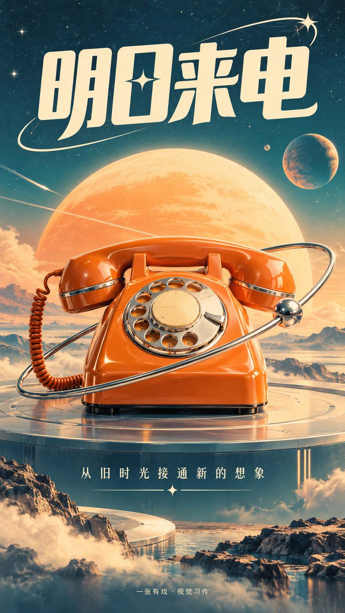
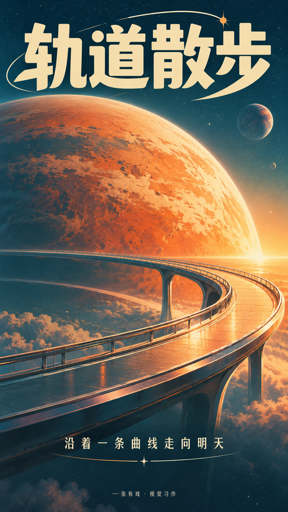
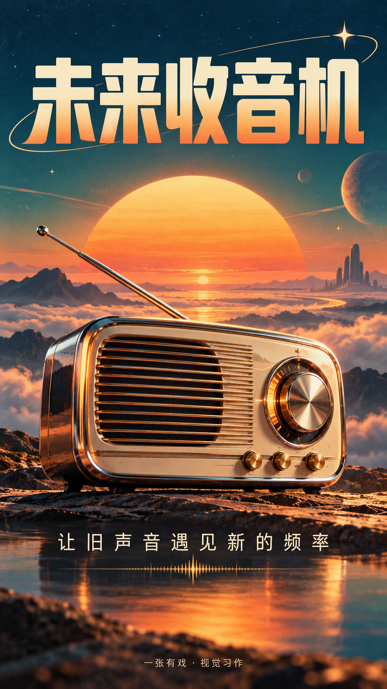
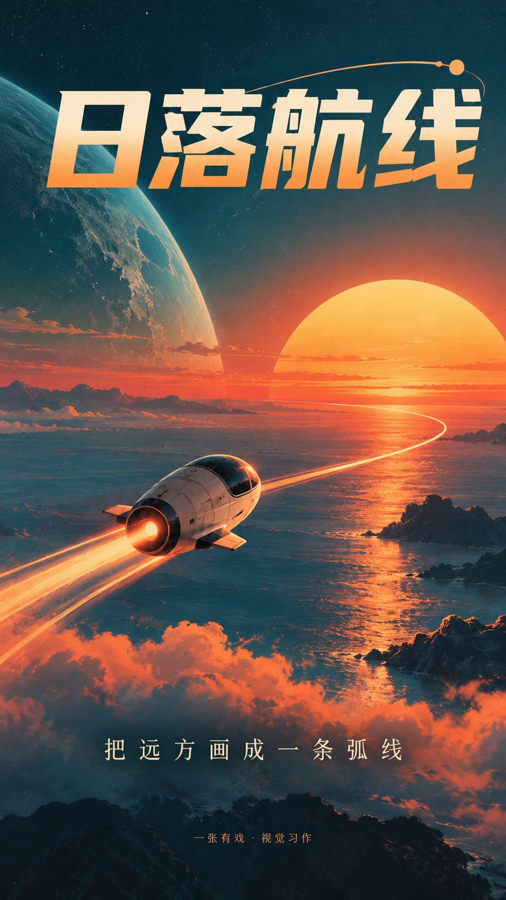
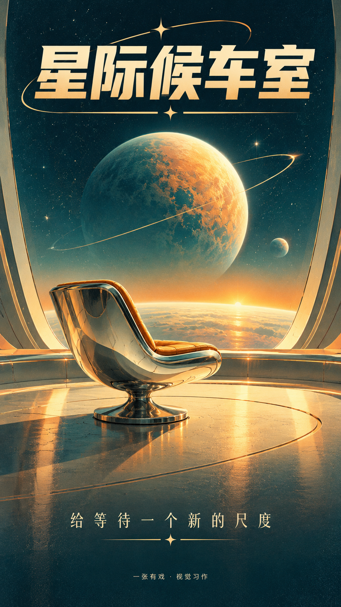
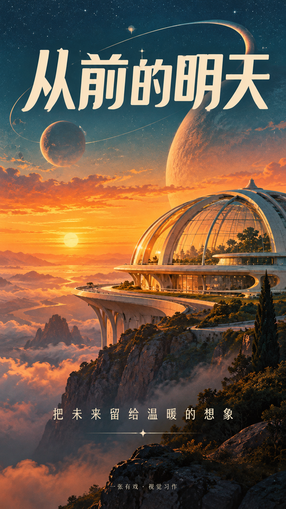
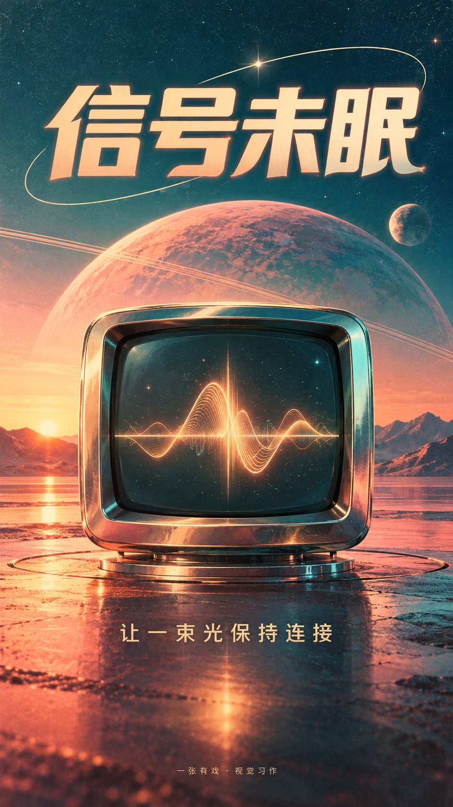
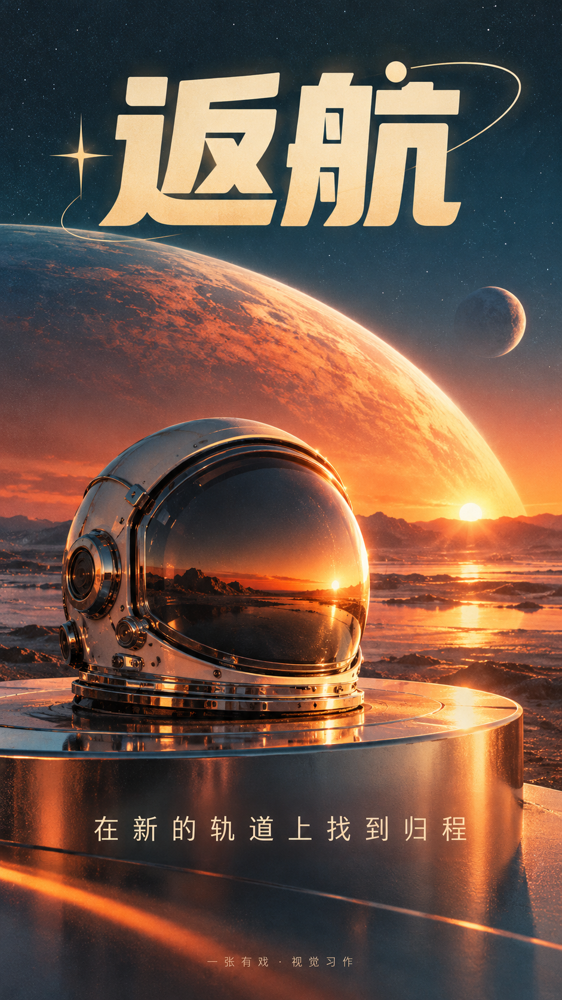

# 复古未来 · Retro Futurism Poster Skill

一张有戏「复古未来」风格中文海报技能。9:16 竖版，主标题 + 短句 + 页脚，简洁可控。

A poster-generation skill for the **retro futurism** style by 一张有戏 (EricChan): 9:16 portrait, Simplified Chinese, one headline, one supporting line.

## 作品展示 · Gallery

<table>
<tr><td align="center"> 明日来电</td><td align="center"> 轨道散步</td><td align="center"> 未来收音机</td></tr>
<tr><td align="center"> 日落航线</td><td align="center"> 星际候车室</td><td align="center"> 从前的明天</td></tr>
<tr><td align="center"> 信号未眠</td><td align="center"> 返航</td></tr>
</table>

## 使用 · Usage
See [SKILL.md](SKILL.md). Full prompts: [PROMPTS.json](PROMPTS.json). 小红书配文：[XIAOHONGSHU_COPY.md](XIAOHONGSHU_COPY.md).

## 来源 · Credits
Adapted from [howardz27/poster-generator-skill](https://github.com/howardz27/poster-generator-skill) (MIT, © 2026 yinnhao). See [SOURCES.md](SOURCES.md).

## License
MIT © 2026 EricChan (ericchan916)
